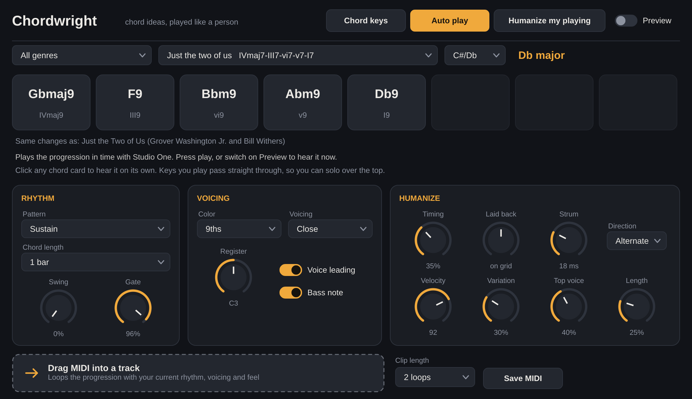

# Chordwright

A chord plugin for Studio One on Mac. It sits on its own instrument track, writes chords as MIDI, and sends them to any Arturia, Native Instruments or other synth on a second track. Every chord comes out with player-style timing, strum, velocity and voice leading.

- 39 progressions across pop and rock, R&B and neo soul and gospel, hip hop and trap, EDM and house. Each one lists famous songs built on the same changes where there's a well-known example.
- Progressions are stored as Roman numerals, so all 12 keys keep the exact pattern and chord qualities. A minor progression stays minor in any key.
- Five color levels (as written, triads, 7ths, 9ths, lush) and four voicing styles (close, open, wide, rootless).
- Voice leading picks the nearest inversion for each chord so the top line moves by small steps.



## Install

See `INSTALL.txt`. It ships inside the zip that GitHub builds.

## Set up in Studio One

1. Drag **Chordwright** (Instruments, vendor "Kristian") onto the arrange view. Use the VST3. Studio One passes MIDI out of VST3 instruments only.
2. Add your synth (Pigments, Analog Lab, Kontakt, Massive X) on a second instrument track.
3. Set the second track's input to **Chordwright**.
4. Turn on monitoring on both tracks. Arm the synth track to record what Chordwright plays.

## Play modes

**Chord keys.** One key, one chord.
- The octave starting at C2 (Studio One naming, MIDI note 48) plays the seven chords of the key on the white keys. Black keys play borrowed color chords (II7, bIII, iv, bVI, bVII in major).
- C3 (middle C) up to C4 plays the cards on screen, slots 1 to 8, white keys only.
- Anything outside those two octaves passes straight through, so you can play a melody up top.
- The "keyboard zone" box moves both octaves up or down.

**Auto play.** Plays the progression in time with Studio One's transport. Switch on **Preview** to hear it with the transport stopped. Changing the key or progression while it plays takes effect at once.

**Humanize my playing.** Plays your notes back with the humanize settings. With strum above 0 ms it waits 20 ms to collect the notes of a chord, then strums them in pitch order.

Click any chord card to hear it on its own.

## Controls

| Section | Control | What it does |
|---|---|---|
| Rhythm | Pattern | Sustain, half notes, quarter pulse, eighth pulse, offbeat stabs (house), Charleston, pop 3-3-2, guitar strum (D D U U D U), half-time stab, shuffle, two arpeggios |
| | Chord length | 1 beat, 2 beats, 1 bar or 2 bars per chord |
| | Swing | Delays off-beat 8ths (or 16ths on 16th patterns) toward a triplet feel |
| | Gate | Note length as a share of each hit. 100% is legato |
| Voicing | Color | Adds or strips 7ths, 9ths, 11ths and 13ths. The 7th quality follows the key (G7 in C, Gmaj7 in G) |
| | Voicing | Close, open (drop 2), wide (drop 2 and 4), rootless (3rd, 7th, 9th, 13th over the bass) |
| | Register | Where the chords sit. C3 is middle C |
| | Voice leading | Nearest inversion instead of root position every time |
| | Bass note | Adds the root, or the slash bass, below the chord |
| Humanize | Timing | Drift off the grid, 0 to 30 ms. It wanders like a player instead of jumping at random |
| | Laid back | Plays every chord behind the beat (positive) or ahead of it (negative) |
| | Strum | Time from first to last note. Up strokes run faster and softer, like a guitar |
| | Direction | Down, up, alternate (down on the beat, up off the beat) or random |
| | Velocity | Base velocity for auto play. Chord keys use how hard you press |
| | Variation | Velocity movement between hits |
| | Top voice | Brings the top note forward and softens the inner voices, the way pianists voice a melody |
| | Length | Variation in note lengths |

Drag the box at the bottom into any Studio One track to drop a MIDI clip of the progression with all of these settings applied. **Save MIDI** writes the same clip to a file.

## Building

GitHub builds the plugin on every push (`.github/workflows/build-mac.yml`): a universal binary for Apple Silicon and Intel, signed for local use, checked by the engine tests and pluginval. Download it from the **Actions** tab, open the latest run, and grab **Chordwright-mac** under Artifacts.

To build on a Mac yourself, install Xcode and CMake, then:

```
cmake -B build -DCMAKE_BUILD_TYPE=Release
cmake --build build --config Release
```

## Adding progressions

Open `Source/ProgressionLibrary.cpp` and add a line in the genre you want:

```
P ("My progression", pop, false, "I iii vi IV", {}, ""),
```

The fields are name, genre, minor key (true or false), numerals, chord lengths (empty means every chord gets the same length), and songs that use it. Numerals support `I ii bVII #iv°7 iiø7 V7 Imaj9 ii11 V13 V7b9 IV6 I69 Iadd9 Vsus4 I/V`.

## Tech notes

- C++20 with JUCE 9.0.4 (fetched by CMake).
- `Source/Theory.*` parses numerals, applies color and builds voice-led voicings.
- `Source/Engine.*` holds the rhythm patterns, humanizer and progression player. Neither depends on JUCE, and `tests/EngineTests.cpp` checks them across every progression, key, color and voicing style.
- `Source/PluginProcessor.*` schedules notes sample-accurately, tracks every sounding pitch so nothing sticks, and looks ahead so notes can play slightly ahead of the beat.
- JUCE is free for personal projects under its AGPLv3 or starter license. Check the JUCE license before selling the plugin.
